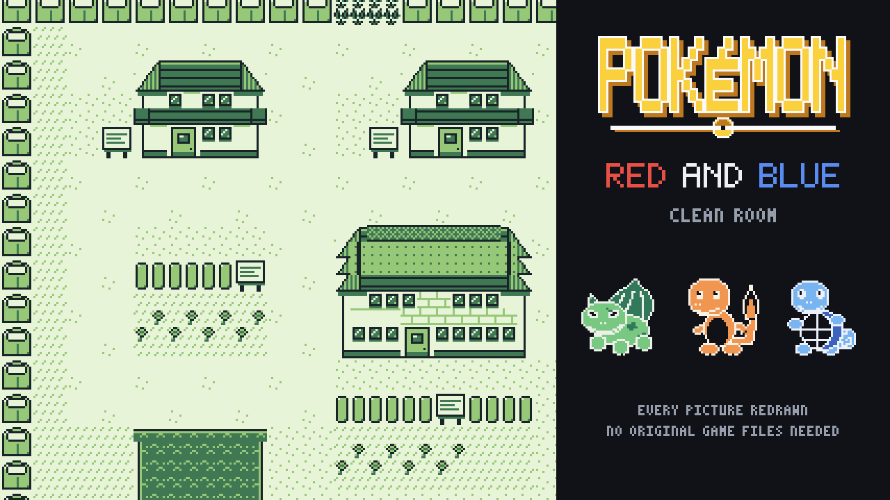

# KITHBOUND Dawn / Dusk

**Play:** https://andrewnakas.github.io/pokered-cleanroom/ (Dawn; `?v=dusk` or the Dusk button switches version)



An original Game Boy RPG built on the **pret/pokered disassembly**. The engine code is assembled from
[pret/pokered](https://github.com/pret/pokered) with rgbds; every creature, trainer, map, tileset, picture, tune,
sound effect, battle animation, table and line of text is made by the generators and briefs in this repository,
with new names, a new region and a new type chart. It runs in the page on EmulatorJS (gambatte core). No original
game file is needed or shipped.

| Part | Kept (structure / anchors only) | New |
|---|---|---|
| Program | the disassembly's engine code | assembled with rgbds 1.0.4 |
| Pictures (509) | size, bit depth, kind | drawn from our briefs (`games/pokered/art/`, `briefs/`) |
| Maps (223) | dimensions, door / warp / object anchors, collision classes | layouts generated (`maps_gen.py`), checked by a map bot (`MAPBOT.md`) |
| Blocksets (19) | block count, collision step classes | recomposed by role (`blocks.py`) |
| Music and effects | channel layout, tempo, loop facts | composed by `cleanroom.audio.compose` (`audio_gen.py`) |
| Tables | sizes and pointer structure | parties, wild tables, type chart, prices, palettes (`tables_gen.py`) |
| Text | slots, lengths, control codes | every line rewritten (`games/pokered/text/new/`) |

Gates, all 0 failing: [ORIGINALITY.md](ORIGINALITY.md) (music, text, images, maps, code windows),
[TAINT.md](TAINT.md) (every picture and built file against the original tiles and streams), [MAPBOT.md](MAPBOT.md)
(every map reachable), plus a ROM word scan.

## Build it yourself

```
git clone -c core.autocrlf=false -c core.eol=lf --depth 1 https://github.com/pret/pokered D:/n64work/pokered/pristine
# rgbds 1.0.4 in D:/n64work/pokered/rgbds, make + a C compiler on PATH
sh games/pokered/build_clean.sh fresh          # generate everything, build Dawn and Dusk
sh games/pokered/gate.sh                       # gates (need the dirty-room name lists and a built pret tree)
sh tools/publish.sh                            # site into D:/n64work/pokered/site
```

The gates' original-name lists are dirty-room files kept outside this repository.

## Credits and licences

- Engine: the pret/pokered disassembly and its contributors.
- Code, drawings and briefs in this repository: MIT (`LICENSE`).
- Runtime in the web page: EmulatorJS (GPL-3.0) and the libretro gambatte core (GPL-2.0); see `THIRD_PARTY.md` on the site.

An unofficial fan project, not affiliated with any publisher.
